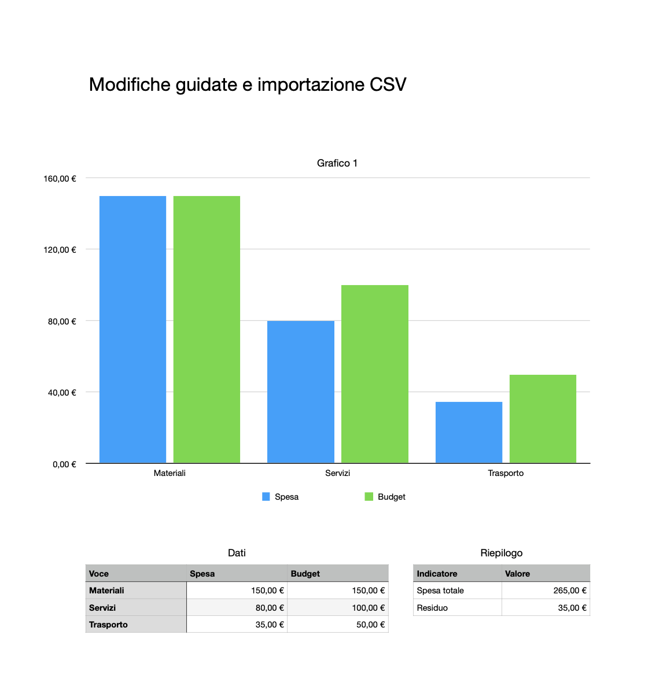

# Numbers Native

[](https://github.com/viames/numbers-native/actions/workflows/ci.yml) [](LICENSE) [](https://github.com/viames/numbers-native/releases/tag/v0.5.0)

[Website](https://viames.github.io/numbers-native/) · [Download](https://github.com/viames/numbers-native/releases/tag/v0.5.0) · [Italiano](README.it.md) · [Support](https://github.com/viames/numbers-native/issues)

Native Apple Numbers tools for Codex, by **Viames Marino**. Open source under the **MIT License**.

Numbers Native lets Codex create, inspect and edit real `.numbers` documents through the Apple Numbers application. Numbers performs the calculations and saves its own native format. No Excel conversion, XLSX library, reverse-engineered file writer, remote MCP service or additional OpenAI API key is involved.

**Version 0.5.0 is a preview.** Local native verification and portability checks do not establish compatibility on every Mac. See [verification](docs/VERIFICATION.md) and [feature coverage](plugins/numbers-native/docs/CAPABILITIES.md).

## Requirements

- A Mac with Apple Numbers installed, in a logged-in graphical session.
- Node.js **22 or later**, available on the Codex host's PATH.
- A Codex environment supporting local stdio MCP servers and plugin marketplaces.
- Permission for the actual host shown by macOS to control Numbers under **System Settings → Privacy & Security → Automation**.

This version uses Apple Events and does not require Accessibility permission. It cannot run its native tools in a Linux/Windows or isolated cloud executor.

## Install in Codex

```sh
codex plugin marketplace add viames/numbers-native
codex plugin add numbers-native@viames-numbers
```

Start a new local Codex task and run the setup skill. You can also add `https://github.com/viames/numbers-native` through **Add plugin marketplace** in compatible desktop clients.



The synthetic example shows a native chart updating to Materiali 150 EUR, total 265 EUR and residual 35 EUR.

## Download a release

Unzip the **marketplace release** into a permanent directory. It contains `.agents/plugins/marketplace.json` and `plugins/numbers-native/`. The bundled server includes its JavaScript dependencies, so users do **not** need to run `npm install`.

With a recent Codex CLI, from the extracted directory:

```sh
codex plugin marketplace add .
codex plugin add numbers-native@viames-numbers
```

Start a new Codex session and invoke `@Numbers Native` or its Numbers/setup skill. In desktop clients supporting repository marketplaces, open this extracted directory as a project and select the **Viames Numbers** marketplace in Plugins. Host versions and workspace policies can affect marketplace discovery; the CLI registration is explicit.

If your desktop host cannot find `node`, install Node.js and ensure it is on that host's PATH. You can alternatively register the MCP server directly in a compatible client's MCP configuration, using the **absolute path** of the extracted server:

```json
{
  "mcpServers": {
    "numbers-native": {
      "command": "node",
      "args": ["/absolute/path/to/numbers-native/plugins/numbers-native/dist/server.mjs"]
    }
  }
}
```

The raw MCP configuration is a fallback for clients that support stdio MCP; it does not install the plugin's skills. Configure Codex's direct MCP connection with its native TOML format if using that route. Do not paste JSON into `config.toml`.

Run setup, then try:

> Create a native Numbers document in my chosen folder, with two independent tables and formulas for a monthly budget. Read back the totals and save the .numbers file.

> Inspect the Numbers document I identify, find the Expenses table and update only the values I provide.

## Coverage and limits

The plugin exposes 38 typed MCP tools for documents, templates, sheets, tables, range reads/writes, native formulas, formatting, clear/merge, sort/transpose, rows/columns, selection, search, text/shapes/images and existing-object geometry. Optional PDF/CSV exports are performed by Numbers itself.

Version 0.5.0 adds guarded multi-table cell edits, read-only native-result checks and typed CSV/TSV append/upsert. See [data workflows](plugins/numbers-native/docs/DATA-WORKFLOWS.md). Version 0.4.0 added complete native/companion backup, restore and move/rename, native PDF/PNG previews (including guided before/after images), and local compatibility diagnostics. See [file/preview workflows](plugins/numbers-native/docs/FILES-PREVIEW.md). Compatible-format preservation, custom prototypes and guided source updates remain available. It retains the 11 native template chart profiles. See the [new workflow](plugins/numbers-native/docs/GUIDED.md). Column, bar, pie, donut, radar, interactive column, stacked column, area, dual-axis, scatter and bubble charts are supported. See the [chart workflow](plugins/numbers-native/docs/CHARTS.md). Dual-axis, scatter and bubble retain fixed axis captions (weather, fuel consumption and sales); use their documented data meanings. Profiles are verified for Numbers 14.5 and fail explicitly on unverified releases or changed template structures.

Read/write calls are limited to **2,000 cells**, row/column insert/delete calls to **100 items**. Page through large tables. Plain strings are literal text, including leading `=` and leading zeroes. Formulas require `{ "formula": "=SUM(B2:B5)" }`. Dates require `{ "date": "2026-10-18T10:30:00Z" }`. Booleans use native checkbox cells. Numbers may return formulas and formatted values in its current document language.

Charts can be created in **new documents** from verified template profiles, with up to 100 points and profile-specific limits of 1–10 numeric columns. Source cells remain editable with normal Numbers tools; Numbers updates the connected chart. Chart type, series references, colors, internal title and arbitrary insertion into existing documents are not exposed. An optional heading is a separate native text item. Pivot creation, conditional rules, comments, collaboration, passwords, detailed number formats and native duplication remain unsupported.

Numbers autosaves. Writes are **not atomic** and can partially apply. Multiple calls in one server and across cooperating plugin servers are serialized, but the user and other apps can still edit simultaneously. Inspect state after errors; never automatically retry timed-out mutations. The plugin leaves unrelated documents open.

## Privacy and local execution

The MCP bridge does not make network requests, listen on a network port, collect telemetry or upload documents to a separate service. **Inputs and results pass through Codex and may be sent to its model** according to the host's policies. Local automation does not mean all spreadsheet data remains on the device.

By default, tools can access explicitly selected local paths and identified open documents. To restrict access, set `NUMBERS_NATIVE_ALLOWED_ROOTS` in the MCP server environment to a JSON array of existing absolute directories:

```json
{ "NUMBERS_NATIVE_ALLOWED_ROOTS": "[\"/Users/your-user/Documents/Numbers\"]" }
```

Paths are canonicalized to reject symlink escapes. This is an additional bridge check, not an OS sandbox for Numbers itself. Numbers can resolve its own file dependencies. [Privacy details](plugins/numbers-native/docs/PRIVACY.md).

## Develop and verify

```sh
npm ci
npm test
npm run build
npm run test:native
npm run test:charts
npm run test:guided
npm run test:files
npm run test:workflows
npm run package
```

`test:native` launches Numbers, creates its own temporary documents and tests their native results. It never uses user documents as fixtures. It needs GUI/Automation permission and is separate from portable CI. The unit/MCP tests run on other operating systems; native operations do not.

The release process creates a marketplace ZIP and a standalone plugin ZIP with bundled runtime, skills, native worker, notices and license, plus SHA-256 checksums. Maintainers rebuild from the pinned lockfile. The unbundled source is also included in the standalone plugin for inspection; the marketplace ZIP contains the full source repository.

## Public distribution

The public source marketplace is [viames/numbers-native](https://github.com/viames/numbers-native). Versioned releases include the Codex marketplace ZIP, standalone plugin ZIP, a macOS `.mcpb` bundle, registry metadata and SHA-256 checksums. MCPB clients receive the same native tools; the Codex plugin also includes skills. The official MCP Registry identity is `io.github.viames/numbers-native`; check its live record rather than assuming a registry submission has succeeded. Repository/registry distribution is separate from listing in the official OpenAI directory.

As checked on **18 October 2026**, OpenAI's [desktop-only submission rules](https://developers.openai.com/plugins/deploy/desktop-only) restrict local MCP submissions to approved partners and require the submitting organization to be allowlisted. A functional package is not proof of directory eligibility or approval. See [publication steps](docs/PUBLISHING.md).

Numbers Native is an independent project and is not affiliated with or endorsed by Apple or OpenAI. Apple Numbers is required and is not included.
